# Session Labeling Skills：项目全景说明

> 文档状态：基于 `session-labeling-skills` 0.5.0、taxonomy 0.3.0 和 2026-10-21 的实现状态整理。
>
> 本文面向第一次接触该项目的研发、数据、评审和使用人员，目标是准确说明：项目解决什么问题、如何从原生 session 形成标签和筛选结果、六个 Skill 如何协作、结果如何解释，以及当前实现尚未覆盖什么。

## 项目摘要

Session Labeling Skills 是一套从原生 Agent `session.jsonl` 出发，自动完成会话结构恢复、任务与需求理解、行为和结果证据分析、统一质量标签生成、S1–S4 确定性筛选、审计与原生 session 导出的流水线。

项目不是将历史 Stage 01–06 逐个复制成六个脚本，而是先保留所有会影响最终判断的有效语义，再按照稳定能力边界重组为六个可组合 Skill。历史阶段用于解释语义来源和建立回归基线；新仓库在运行时独立，不依赖历史工程代码。

一句话概括：

> 将“原生 session 中发生了什么”转化为“任务是什么、Agent 做了什么、结果是否有证据、对应哪些统一标签、是否满足高质量入选规则”，并让每一步都可验证、可恢复和可追溯。

---

## 1. 项目背景

历史打标流程由 Stage 01–06 逐步形成。最终筛选虽然集中在后期阶段，但它依赖前序阶段产生的任务边界、用户目标、需求、Agent 行为、结果判断和证据。只迁移最终筛选阶段，会丢失这些判断的来源，得到的只是无法稳定复现的最终标签或布尔结果。

历史流程还存在几类工程问题：

1. **阶段耦合**：后续阶段依赖前序阶段的中间产物，但依赖关系没有统一合同。
2. **重复分析**：多个阶段可能重复解析 session、恢复目标或判断结果。
3. **标签重叠**：不同字段名称可能表达相近概念，也可能名称相近但语义不同。
4. **规则分散**：判断逻辑可能分布在 Python、Prompt、Markdown 和临时脚本中。
5. **证据链不统一**：标签不一定都能稳定回到原始 event 和原文。
6. **复现边界不清**：历史结果一致，不一定意味着从原生 session 重新分析也能得到同样结果。

因此，新项目从“能力依赖”而不是“历史阶段编号”出发，将 Stage 01–06 中仍有效的处理逻辑整理成统一、独立、可审计的端到端系统。

## 2. 重构目标与非目标

### 2.1 重构目标

项目的目标包括：

- 直接接受原生 `session.jsonl`，不要求用户预先准备 Stage 01–05 中间文件；
- 恢复 session 中一个或多个连续 Episode、用户目标、需求及需求演化；
- 建立“用户要求—Agent 行为—工具结果—实际结果—标签”证据链；
- 使用唯一的 canonical taxonomy，消除重复标签和隐式字段映射；
- 使用唯一的 S1–S4 selection policy，确定性地产生筛选决定；
- 将不确定、规则不满足和结构错误区分开，而不是都归入笼统的 `review`；
- 支持批处理、checkpoint、resume、缓存、manifest、审计和原生数据导出；
- 通过分层回归说明兼容性来自哪个环节，避免只比较最终布尔值；
- 保证所有运行时文件访问遵循新存储根和路径安全策略；
- 将流程维护为可自动调用的 Skills，并以独立仓库持续演进。

### 2.2 非目标

当前版本明确不做以下事情：

- 不机械保留 `stage01-skill` 到 `stage06-skill` 的历史目录结构；
- 不把所有历史字段不加判断地复制到 canonical schema；
- 不把 Agent 的完成声明等同于证据验证成功；
- 不用关键词匹配代替 capability taxonomy 的定义、输入、输出和边界判断；
- 不在证据不足时强制给出正向或负向标签；
- 不启用评分排序、top-K、容量上限或 coverage quota；
- 不把 `pending_review` 解释为低质量，也不把 `invalid` 解释为 session 本身质量差；
- 不把冻结历史标签回归描述成从原生 session 重新完成的全新语义复现；
- 不在仓库内保存 API key，也不依赖历史工程的运行时 import。

## 3. 输入输出

### 3.1 输入

单次运行的主要输入是一个原生：

```text
session.jsonl
```

文件可以包含 user、assistant、tool、attachment 以及其他原生记录。ingestion 会保留未知记录和解析限制，而不是静默丢弃。

批处理输入是一个 JSONL 清单。每行至少提供一个 session 文件定位字段，例如：

```json
{"session_jsonl_path": "/approved/new/root/data/session-001.jsonl"}
```

自动语义分析还需要：

- provider 配置文件；
- provider 名称；
- 由 provider 配置引用的环境变量中的 API key；
- 可选模型名称和模型响应缓存目录。

如果没有 provider，也可以完成 ingestion、schema 校验、manifest 和确定性筛选框架，但缺少的语义判断会安全地落入 `pending_review`，不会伪造成完整打标结果。

### 3.2 核心输出

启用模型的单 session run 通常产生：

```text
<run-dir>/
├── normalized_session.json
├── checkpoints/
│   └── semantic_checkpoint.json
├── assessments/
│   └── <assessment-id>/
│       ├── episode.json
│       ├── analysis.json
│       ├── final_labels.json
│       ├── selection_decision.json
│       ├── model_metadata.json
│       └── assessment_checkpoint.json
├── export/
│   └── session.jsonl              # 至少一个 assessment 被选中时生成
└── run_manifest.json
```

主要产物分别回答：

| 产物 | 回答的问题 |
|---|---|
| `normalized_session.json` | 原生 session 被解析成了哪些 records、turns 和 events？ |
| `episode.json` | 当前连续任务的边界、目标和需求是什么？ |
| `analysis.json` | Agent 做了什么，实际结果如何，有哪些原始证据？ |
| `final_labels.json` | 按统一 taxonomy 得到了哪些标签、claim 和 capability mapping？ |
| `selection_decision.json` | S1–S4 和 precheck 的状态是什么，最终是否入选？ |
| `run_manifest.json` | 本次运行使用了什么版本、配置、模型和文件，产物是否完整？ |
| `export/session.jsonl` | 入选 session 的原生字节级副本。 |

## 4. 端到端流程

下图概括从原始 Agent 会话到入选会话的完整方法链。**实线是主处理顺序；虚线是共享来源回查或规则输入。**



阅读时注意三条边界：用户反馈信号只是待核查线索，必须结合完整交互、工具结果和产物核验；问题、Agent 责任及能力缺口不是同一判断；是否入选由 Prechecks 和 S1–S4 决定，痛点归因不能替代筛选。

该图呈现完整方法，不代表当前实现已覆盖每个环节。R1–R8 用户侧分析、候选信号、归因和能力缺口仍有待实现部分，详见[历史字段映射](design/legacy-to-canonical-label-map.yaml)和本文第 13 节。阶段定义及历史依据见[方法说明](method/fig2-a-complete-workflow.md)，可编辑图稿见[Mermaid 源码](method/fig2-a-complete-workflow.mmd)。

## 5. 六个 Skill

六个 Skill 是按能力边界组织的调用说明。CLI 和 Python 实现负责实际执行，Skill 负责说明何时调用、输入输出、约束和不可越过的职责边界。

| Skill | 主要输入 | 主要输出 | 核心职责 | 明确不负责 |
|---|---|---|---|---|
| `session-understanding` | 原生或 normalized session | canonical Episode | 结构标准化、Episode 边界、目标、需求和需求演化恢复 | 不判断 Agent 是否成功，不做最终筛选 |
| `session-evidence-analysis` | Episode 与原始 events | analysis、evidence、execution | 连接需求、Agent 行为、工具结果和实际结果，抽取最小充分证据 | 不凭 Agent 自述认定成功，不定义新 taxonomy |
| `session-quality-labeling` | Episode、analysis、taxonomy | canonical final labels | 生成 claim、capability mapping、任务属性和语义 review | 不自行定义标签，不决定 primary/auxiliary role |
| `session-quality-selection` | 已验证 final labels、selection policy | selection decision | 确定性计算 prechecks 和 S1–S4，给出四类最终状态 | 不调用模型补猜缺失语义，不启用评分或配额 |
| `session-quality-audit` | repository 或完整 run | audit report | 校验 schema、证据、lineage、hash、路径、selector 和导出完整性 | 不把“文件存在”当成可复现证明 |
| `session-labeling-pipeline` | 单个或批量 session、provider 配置 | 完整 run、manifest、export | 编排前五个 Skill，管理 checkpoint、resume、缓存、批处理和回归 | 不绕过各能力合同，不把无模型运行称为完整语义复现 |

这些 Skill 不是历史六个 Stage 的一一改名。一个 Skill 可能吸收多个历史阶段的有效能力；同一种 canonical 信息只允许有一个权威数据来源。

## 6. Canonical 数据模型

canonical 数据链可以表示为：

```text
SourceSnapshot
  └── NormalizedSession
        ├── Records
        ├── Turns
        └── Events
              └── Episode
                    ├── Goal
                    ├── Requirements
                    └── Provenance
                          └── Analysis
                                ├── Evidence[]
                                └── Execution
                                      └── FinalLabels
                                            ├── Claims[]
                                            ├── CapabilityMappings[]
                                            ├── TaskAttributes
                                            ├── SemanticRuleReviews[]
                                            └── SelectionDecision
                                                  └── RunManifest
```

### 6.1 `NormalizedSession`

包含：

- `session_id`；
- `source_snapshot` 与原始文件 SHA-256；
- 原生 `records`；
- 稳定的 `turn_ids`、`turns` 和 `events`；
- ingestion report 和解析限制。

它只负责忠实表示原生记录，不做高层质量判断。

### 6.2 `Episode`

Episode 是一个连续任务单元，包含：

- 来自真实 turn ID 的起止边界；
- 用户目标；
- 明确需求及相关 origin event；
- limitations；
- 窗口发现和 reconcile provenance。

长 session 会通过重叠窗口发现候选 Episode；跨窗口候选再进行定向 reconcile。无法消歧时保留显式 unresolved limitation，而不是静默合并或拆分。

### 6.3 `Evidence` 与 `Analysis`

每条 evidence 至少包含：

- `evidence_id`；
- `source_snapshot_id`；
- `event_id`；
- 来自该 event 正文的连续原文 `quote`；
- 内容摘要 `content_digest`。

Analysis 保存 evidence、Agent 执行情况、每项 requirement 的结果、整体 verified outcome、限制和 provenance。

### 6.4 `FinalLabels`

FinalLabels 将分析转成统一标签合同，包含：

- claims；
- capability mappings；
- task attributes；
- S3/S4 semantic rule reviews；
- execution 的规范化视图；
- scope match；
- selection-critical conflicts；
- limitations、validation issues 和 provenance。

### 6.5 `SelectionDecision` 与 `RunManifest`

SelectionDecision 保存 prechecks、四条规则、最终决定、旧结果兼容视图和 issues。RunManifest 汇总输入 snapshot、assessment 列表、四类决定数量、是否导出、产物 inventory、版本、配置 hash、模型信息和代码状态。

## 7. 标签与证据体系

### 7.1 三个唯一来源

项目通过三个权威来源避免标签和规则漂移：

1. `config/taxonomy.yaml`：唯一标签与 capability registry；
2. `config/selection_policy.yaml`：唯一 S1–S4 和最终决策表；
3. `schemas/`：唯一上下游数据合同。

`prompts/` 只能引用这些定义，不能再维护另一套标签枚举或筛选规则。

### 7.2 当前核心标签

当前 taxonomy 覆盖的核心概念包括：

- Agent 自称结果：`outcome.agent_claimed_status`；
- 证据验证结果：`outcome.verified_status`；
- requirement 有效性：`requirement.validity`；
- requirement 完成情况：`requirement.outcome`；
- Agent 相关归因：`attribution.agent_related`；
- 任务难度：`task.difficulty`；
- capability mapping 状态：`taxonomy.mapping_status`；
- claim 支持状态：`claim.support_status`；
- S1–S4 状态与最终 selection decision。

### 7.3 Primary、auxiliary 和 derived

标签在筛选中的角色不同：

- `primary`：允许参与主要入选资格判断；
- `auxiliary`：用于解释结果，但不能单独满足 S1；
- `derived`：由其他 canonical truth 确定性计算，不由模型独立编辑。

Capability mapping 的角色由 taxonomy registry 决定，模型不能自行选择。仅有 auxiliary mapping 的样本不能通过 S1。

### 7.4 证据原则

项目遵循以下证据要求：

- 每个筛选相关 claim 或 mapping 必须引用有效 evidence；
- quote 必须是对应 event 正文中的连续原文；
- 工具调用只能证明“尝试过”，不能独立证明“成功”；
- 成功通常需要 tool result、文件内容、测试输出、可检查产物或用户确认；
- Agent 的 `claimed_complete` 与 `verified_outcome=success` 是两个不同概念；
- 证据不足时使用 `unknown`、`unable_to_verify`、`unresolved` 或 `insufficient`；
- 不同 Episode 的证据不能拼接起来支持同一个 claim；
- 冲突证据必须保留到明确的复核步骤解决。

历史字段的覆盖状态由 `docs/design/legacy-to-canonical-label-map.yaml` 记录。该文件区分 `implemented`、`derived`、`historical_only` 和 `explicitly_deferred`，不能把理论上可能重建的字段直接宣称为已实现。

## 8. S1–S4 筛选规则

当前 selection policy ID 为 `stage06-selection-v3-compatible`，以 assessment/Episode 为主要判断单元。

### 8.1 Prechecks

在 S1–S4 之前先检查：

| Precheck | 含义 |
|---|---|
| `valid_schema` | 标签是否符合 canonical schema |
| `valid_references` | evidence、claim、mapping 和 source 引用是否有效 |
| `scope_match` | 是否满足配置的 domain、work object 或 taxonomy scope |
| `no_selection_critical_unresolved_conflict` | 是否不存在影响筛选的未解决冲突 |

当前空 scope filter 表示“不限制”，不是“什么都不选”。

### 8.2 S1：主需求及具体子需求成立

通过条件：至少有一个 role 为 `primary` 的 capability mapping，同时满足：

- mapping 状态为 `supported`；
- 包含 evidence refs；
- 所有 evidence refs 都有效。

没有 primary mapping 或 primary mapping 未解决时为 `pending`；存在 primary mapping 但没有任何证据支持项时为 `fail`。

### 8.3 S2：任务有实质性挑战

依据 task difficulty：

- `medium`、`high`：`pass`；
- 经审查的 `low`：`fail`；
- `unknown` 或无法判断：`pending`。

难度判断关注任务的推理、约束、工具环境、工作流依赖和验证负担，而不是简单按文本长度判断。

### 8.4 S3：能还原连贯的任务要求

S3 是带证据的语义审查，判断是否能够恢复同一个任务的连贯目标、对象、需求、约束、演化和范围。缺少 S3 review 时为 `pending`，不会默认通过。

### 8.5 S4：完成条件可从已有记录明确

S4 判断现有记录是否提供可核对的完成条件，例如用户明确要求、测试、输出、指标或可检查标准。不能把 taxonomy 中通用的输出描述反向虚构成当前案例的验收标准。缺少 S4 review 时为 `pending`。

### 8.6 确定性决策表

最终决定顺序是：

1. 任一 precheck 或规则为 `invalid`：`invalid`；
2. `scope_match=fail` 或任一 S1–S4 为 `fail`：`not_selected`；
3. 所有 precheck 和 S1–S4 都为 `pass`：`selected`；
4. 其他包含未决状态的组合：`pending_review`。

当前策略不计算 selection score，不做 top-N 截断，也没有 capacity 或 coverage quota。

## 9. 最终结果及导出策略

### 9.1 四类 canonical 结果

| 结果 | 含义 | 后续处理 |
|---|---|---|
| `selected` | 结构、引用、scope 和 S1–S4 全部通过 | 进入高质量候选；触发原生 session 导出 |
| `not_selected` | 数据可正常判断，但 scope 或至少一条规则明确失败 | 保留原因，不进入候选集 |
| `pending_review` | 信息或语义判断不足，尚不能可靠选中或排除 | 补充模型分析或人工复核 |
| `invalid` | schema、引用、lineage 或运行产物存在硬错误 | 修复数据或重新运行；不能作为质量结论 |

旧结果兼容映射为：

| Canonical | Legacy view |
|---|---|
| `selected` | `priority_candidate` |
| `pending_review` | `review` |
| `invalid` | `review` |
| `not_selected` | `not_selected` |

旧 `review` 被拆成“语义未决”和“结构无效”两类，避免混淆。

### 9.2 当前导出策略

筛选发生在 assessment/Episode 层。一个原生 session 可以包含多个 Episode，因此不同 assessment 可以得到不同结果。

当前 pipeline 的 session 级导出策略是：

> 只要该 run 中至少有一个 assessment 的决定为 `selected`，就将整个原生 `session.jsonl` 按字节复制到 `export/session.jsonl`。

Manifest 会记录四类结果的数量和 `exported_native_session`。审计会验证：

- 是否确实存在 selected assessment；
- export 是否出现在 artifact inventory；
- export SHA-256 是否与输入 source snapshot 一致；
- 非入选 run 中是否残留了过期 export。

当前版本尚未实现“只裁剪导出被选中的 Episode”。如果后续需要 Episode 级数据集，应单独定义裁剪时的上下文保留和 provenance 规则，不能直接丢弃 session 其余部分。

## 10. 可恢复性与审计机制

### 10.1 Checkpoint 与 resume

模型辅助运行会保存：

- understanding checkpoint；
- 每个 assessment 的 complete checkpoint；
- 每次模型调用的 provider、model、cache key、attempt 和 usage 等 metadata。

恢复不是简单地检测文件存在。复用前会检查：

- source snapshot hash；
- taxonomy 与 selection policy；
- pipeline version；
- provider 和 model；
- checkpoint schema 和状态；
- Episode、analysis、labels、selection 的 ID join；
- manifest inventory 中的文件 SHA-256 和 size。

输入文件、taxonomy、policy、pipeline/model 配置发生变化时，相关签名会变化，旧 checkpoint 不应被静默复用。

### 10.2 模型调用和缓存

模型使用 JSON Schema strict output、temperature 0 和 bounded retry。响应在进入下游前执行 schema 校验。缓存 key 来自完整结构化请求；缓存命中时仍会重新校验响应 schema。

API key 只从 provider 配置指定的环境变量读取，不写入仓库或 manifest。

### 10.3 Run audit

`session-labeling audit --kind run` 会验证：

- manifest 和所有 artifact schema；
- artifact inventory 的 hash 与 size；
- session、source、Episode、assessment、analysis、labels 的 lineage join；
- evidence event ref 和 exact quote；
- analysis 与 final labels 中 execution 的一致性；
- selector 重新计算结果与已保存决定是否一致；
- manifest decision 与 assessment decision 是否一致；
- selected assessment 与原生 export 的对应关系；
- export SHA-256 是否与原始输入一致；
- 是否存在缺失、篡改或过期产物。

### 10.4 Repository audit 与路径安全

Repository audit 检查：

- 禁止存储根字面量；
- 运行时代码对历史工程的 import；
- 无法读取的仓库文件。

所有 session、清单、配置和产物 I/O 都经过 `PathPolicy`。历史 locator 只能先在内存中进行纯词法映射，不能对未映射 locator 执行 `open`、`stat` 或 `resolve`。映射后的路径必须位于允许的新根内，符号链接被逐级拒绝，最终文件读取使用 no-follow 语义。

## 11. 使用示例

以下命令均应在仓库根目录执行，并将示例路径替换为新存储根下的实际路径。

### 11.1 安装

源码模式：

```bash
python3 -m pip install -e .
```

创建本地 provider 配置；真实 provider 地址和环境变量绑定不提交到 Git：

```bash
cp config/providers.example.yaml config/providers.yaml
```

### 11.2 只做确定性标准化

```bash
session-labeling normalize \
  --input /approved/new/root/data/session.jsonl \
  --output /approved/new/root/runs/example/normalized_session.json
```

### 11.3 对已有 canonical labels 重新筛选

```bash
session-labeling select \
  --labels /approved/new/root/runs/example/final_labels.json \
  --output /approved/new/root/runs/example/selection_decision.json
```

### 11.4 完整处理单个 session

```bash
session-labeling run \
  --input /approved/new/root/data/session.jsonl \
  --run-dir /approved/new/root/runs/session-001 \
  --provider-config "$PWD/config/providers.yaml" \
  --provider pjlab_proxy \
  --cache-dir /approved/new/root/cache/session-labeling
```

默认启用 resume；需要强制重新运行时可显式加入 `--no-resume`。

### 11.5 批量处理

```bash
session-labeling batch \
  --input-list /approved/new/root/data/sessions.jsonl \
  --output-dir /approved/new/root/runs/batch-001 \
  --limit 10 \
  --provider-config "$PWD/config/providers.yaml" \
  --provider pjlab_proxy \
  --cache-dir /approved/new/root/cache/session-labeling
```

### 11.6 审计

审计单次 run：

```bash
session-labeling audit \
  --root /approved/new/root/runs/session-001 \
  --kind run
```

审计仓库：

```bash
session-labeling audit \
  --root "$PWD" \
  --kind repository
```

推荐的正式运行顺序是：

```text
run 或 batch
  → 检查 manifest decision summary
  → 对每个 run 执行 run audit
  → 仅发布 audit valid 的 selected export
```

## 12. 回归验证

回归必须分层解释，不能只看最终决定是否一样。

理想的 fresh semantic regression 应比较：

1. 原生 session 是否正确 ingestion；
2. Episode 边界是否一致或差异是否合理；
3. 用户 goal、requirements 和 evolution 是否一致；
4. Agent action、tool result 和 outcome 是否一致；
5. 关键 evidence 是否覆盖且引用准确；
6. 旧标签映射到 canonical taxonomy 后是否一致；
7. S1–S4 状态是否一致；
8. 最终 decision 是否一致；
9. 差异来自哪一个上游环节。

当前已完成的是 10-session 冻结兼容回归：

- 10/10 sessions 成功 ingestion；
- 13/13 历史 cases 存在基线；
- 13/13 S1–S4 状态匹配；
- 13/13 最终决定匹配；
- 共处理 19,679 条 JSONL records、38,140 个 canonical events 和 950 个 turns；
- 该样本没有 parse error。

这项验证使用显式 compatibility adapter 将冻结历史标签映射为 canonical labels，再由新 selector 重算。它证明：

> 原生 ingestion、冻结标签迁移和新的确定性 selector 在该样本上保持了历史筛选决定。

它不证明：

> 新流程已经通过模型从原生 session 全新恢复 Episode、goal、requirements、evidence 和 labels，并完整复现 Stage 01–06 的全部语义。

后者需要配置可用 provider 后完成 fresh model-assisted regression。

## 13. 当前完成度和已知限制

### 13.1 已实现并验证

截至 2026-10-21，当前基线为：

- package/pipeline 版本 `0.5.0`；
- taxonomy 版本 `0.3.0`；
- 六个 Skill 已建立；
- 独立原生 ingestion 已实现；
- canonical Episode、analysis、evidence、labels 和 selection 已实现；
- 跨窗口 Episode reconcile 和 unresolved fallback 已实现；
- S1–S4 确定性 selector 已实现；
- checkpoint/resume、manifest、artifact inventory 和模型缓存已实现；
- run audit、repository audit 和原生 session 导出已实现；
- 29/29 单元测试通过；
- 6/6 Skill 通过官方 quick validation；
- `0.5.0` wheel 可构建、安装，并可从 wheel 加载 prompt/schema/config 资源；
- 冻结兼容回归达到 10/10 sessions、13/13 cases 的规则和决定一致。

### 13.2 历史语义覆盖状态

`docs/design/legacy-to-canonical-label-map.yaml` 当前记录 51 项历史字段 disposition：

- 25 项 `implemented`；
- 0 项 `derived`；
- 3 项 `historical_only`；
- 23 项 `explicitly_deferred`。

主要 deferred 区域包括：

- initial query 和 query clarity；
- preliminary goal 与最终 goal 的区分；
- user-stated requirement、origin 和更完整的 requirement evolution；
- user signals；
- coarse scope / analysis-value screen；
- goal verification；
- failure attribution、failure category 和 capability gap；
- 完整 Stage 06 task attributes；
- assessment target / case requirements；
- episode/requirement assessment；
- feedback/failure annotations；
- review summary 和 claim review events。

这些字段被明确标记为 deferred，而不是隐藏在 outcome、S3 或 S4 中假装已经实现。

### 13.3 当前已知限制

- 尚未完成有可用 provider 的 10-session fresh semantic regression；
- 当前 frozen regression 样本中的 13 个 case 均为历史 `priority_candidate`，因此尚未充分覆盖 `not_selected`、`pending_review` 和 `invalid` 的真实分布；
- 当前 session 导出策略是“任一 Episode selected 即导出整个原生 session”，不是 Episode 裁剪导出；
- 当前不支持 selection score、容量和覆盖配额；
- 部分历史审查工作流和失败归因语义仍未进入 runtime contract；
- 仓库尚未配置真实 Git remote 和提交身份，因此不能把本地目录状态描述为已经正式发布到 GitHub；
- 没有 provider 或 canonical labels 输入时，语义字段会保持未决，最终结果通常为 `pending_review`。

## 14. 后续路线图

建议按以下顺序继续推进。

### Phase A：补齐影响语义等价的 canonical contract

优先补充仍会影响历史判断的 deferred 字段，并同步更新：

- schema；
- model output schema；
- prompt；
- Python 构造和规范化逻辑；
- auditor；
- legacy-to-canonical map；
- 单元测试和 Skill 文档。

不能只更新映射文档，也不能用现有 outcome 或 pain 字段代替 failure attribution 等不同语义。

### Phase B：扩大确定性测试覆盖

增加针对以下情况的 fixtures：

- 明确 `not_selected`；
- 语义不足的 `pending_review`；
- schema、reference、lineage 损坏导致的 `invalid`；
- 一个 session 多个 Episode 且结果混合；
- evidence 冲突；
- requirement evolution 和跨窗口边界；
- selected export 与 stale export 检测。

### Phase C：Fresh semantic regression

在远程安全配置 provider 凭据后：

1. 先运行一个最小 session，检查费用、schema、quote 和模型行为；
2. 再对冻结的 10 sessions 从原生输入全新运行；
3. 分层比较 Episode、goal、requirements、outcome、evidence、taxonomy、S1–S4 和最终决定；
4. 对每个差异标记来源：合同变化、模型波动、历史缺陷或新流程缺陷；
5. 形成可复核的 fresh regression 报告。

### Phase D：明确发布和导出策略

根据下游数据用途决定是否继续采用整 session 导出，或新增：

- Episode 级裁剪导出；
- session 级聚合 decision；
- selected Episode 上下文保留规则；
- pending/invalid 隔离队列；
- 人工 review 的版本化写回合同。

### Phase E：独立仓库发布

在提供真实 Git remote 和提交身份后：

- 建立首个可审计 commit；
- 配置 CI：unit tests、schema tests、Skill validation、repository audit 和 wheel smoke test；
- 发布版本化 taxonomy、selection policy 和 migration notes；
- 为数据、模型和代码版本建立可重复的 release manifest。

---

## 结论

该项目当前已经形成一条真实可运行的主链路：

```text
原生 session
→ 标准化
→ Episode/目标/需求恢复
→ 行为、结果和证据分析
→ 统一标签
→ S1–S4 筛选
→ 审计
→ 高质量原生 session 导出
```

它的核心价值不仅是“自动打标签”，而是将历史上分散的语义判断整理成一套具有单一数据合同、单一标签注册表、单一筛选规则、证据引用、确定性决策和审计能力的系统。

当前工程骨架和主要能力已经实现，但完整 Stage 01–06 语义等价仍是一个需要继续验证的目标。最准确的项目状态是：

> 已建立可自动运行、可恢复、可审计的 canonical labeling/selection pipeline，并验证了冻结标签迁移与 selector 的兼容性；仍需补齐明确 deferred 的历史语义，并通过模型辅助的 fresh semantic regression 证明端到端语义复现能力。
